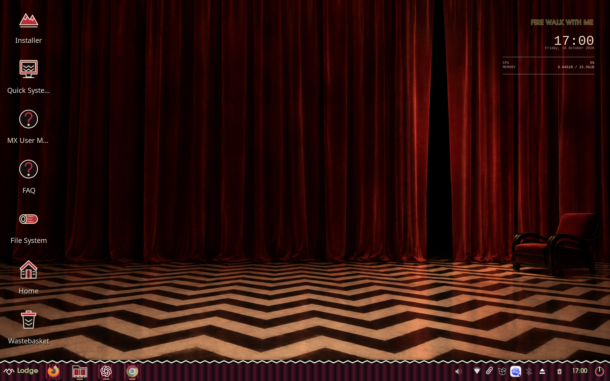
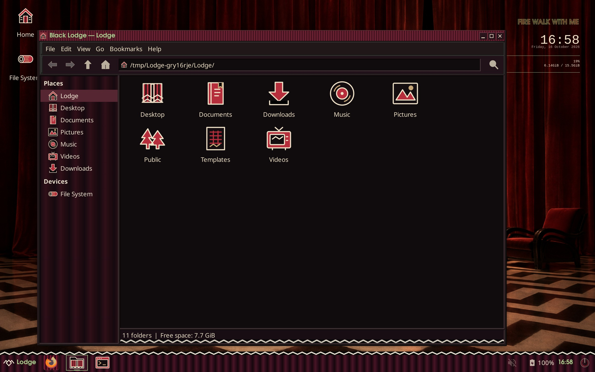
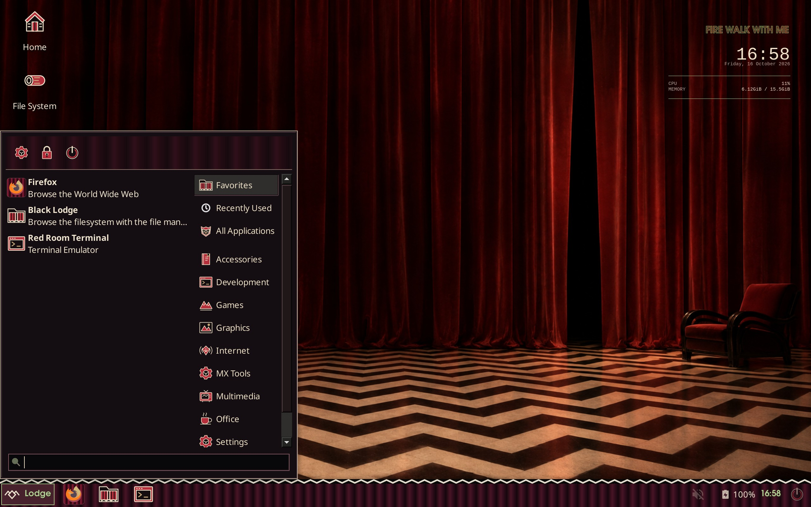
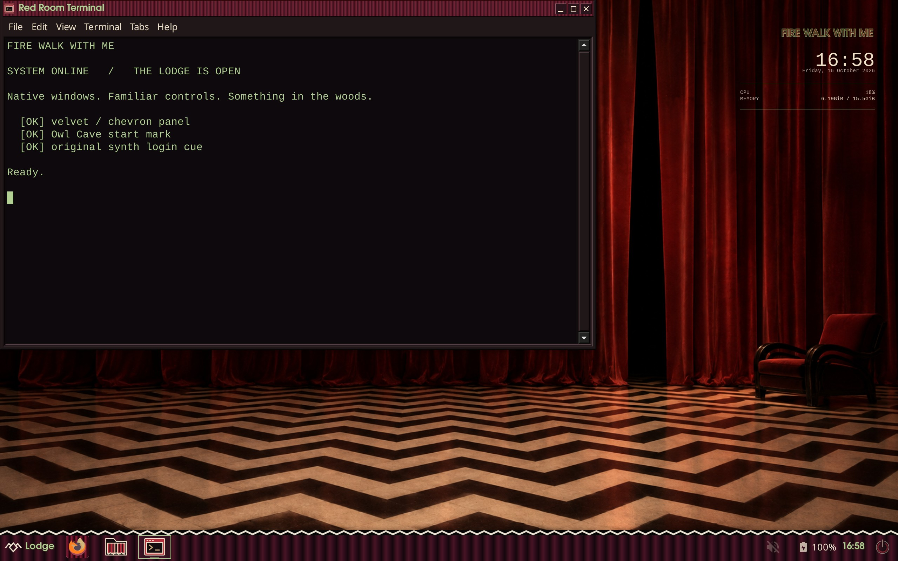

# Fire Walk With Me

An unofficial Twin Peaks-inspired XFCE skin: red velvet, black/ivory chevrons, green opening-title lettering, and familiar native controls.



- One continuous velvet taskbar, an Owl Cave Start mark, and stable hover/active borders.
- Native GTK2/3/4 styles and XFWM decorations, including a HiDPI variant.
- Distinct special-folder icons, themed cursors, and recognizable application logos. Optional ChatGPT white knot over red curtains.
- **Black Lodge** file-manager launcher/window names and **Red Room Terminal** with green text.
- An original deep-bass synth login cue, **Into the Lodge**. No show music or samples.
- Reversible user installation, system defaults, new-user setup and LightDM appearance settings.



Tested on MX Linux / XFCE 4.20 / X11, with 1× and 2× screenshots. [Review record and limits](docs/verification.md) · [Visual references](docs/design.md) · [Credits](docs/credits.md).

## Install

Start with an existing XFCE desktop. On Debian/MX, the additional packages used by this skin are:

```sh
sudo apt install python3-dbus python3-gi gir1.2-gtk-3.0 gir1.2-wnck-3.0 \
  librsvg2-bin x11-apps papirus-icon-theme fonts-urw-base35 conky-all \
  xfce4-whiskermenu-plugin xfce4-docklike-plugin xfce4-pulseaudio-plugin \
  xfce4-power-manager-plugins pulseaudio-utils
git clone https://github.com/GeorgeFejer91/fire-walk-with-me.git
cd fire-walk-with-me
```

Install for your account and apply to the running desktop:

```sh
./install.sh --startup-sound --fetch-chatgpt-logo
```

Both flags are optional. `--startup-sound` enables the original cue at XFCE login. `--fetch-chatgpt-logo` downloads a pinned official logo for the local curtain composition; the source repository does not vendor that mark. Available Papirus app sources are composed locally; missing artwork inherits the installed icon theme.

To make it the system default, including new accounts and LightDM's appearance, build as your regular user, then install:

```sh
python3 tools/build.py --fetch-chatgpt-logo
sudo ./install.sh --system --startup-sound
./install.sh --apply-only --startup-sound
```

The last command applies the system assets to your current desktop. Existing panel launchers and pins are retained; the clean bottom-panel layout is the new-user default. Display scaling is retained. The login helper chooses matching window decorations and panel texture. Thunar's command, file operations and shortcuts remain available.

System installation writes named assets under `/usr/share`, defaults under `/etc/xdg`, `/etc/gtk-*` and `/etc/skel`, launcher overrides under `/usr/local/share/applications`, and LightDM's existing GTK greeter appearance settings when present. It does not restart the display manager.

The sound plays after desktop login. It does not replace a firmware chime. No reboot, power setting, bootloader or audio driver change is part of installation.

## Restore

Private rollback records live outside the checkout. Repeated installs retain the original backup.

```sh
./install.sh --restore
# If system defaults were installed, restore those as well:
sudo ./install.sh --system --restore
```

Rollback restores the files and desktop properties touched by installation. A later login reloads previous autostart programs. Save any subsequent edits to those same configuration files before restoring them.

## Check or reproduce screenshots

```sh
python3 tools/build.py
python3 tools/verify.py
python3 tools/preview.py --scale 2 --output artifacts/preview-2x
python3 tools/preview.py --scale 1 --output artifacts/preview-1x
```

Verification additionally uses `gir1.2-gtk-4.0`. Screenshot capture uses `xvfb`, `xauth`, `wmctrl`, `xdotool` and `scrot`. Previews run a real, disposable XFCE session with synthetic folders and text; they do not capture your private applications. Inspect the resulting images before publishing them.





Apps with custom-drawn interfaces, libadwaita styling or their own tray images may retain their own appearance. GTK2 rendering and the live LightDM greeter are not fully visually qualified. GPL-3.0; see [LICENSE](LICENSE) and the third-party [credits](docs/credits.md).
