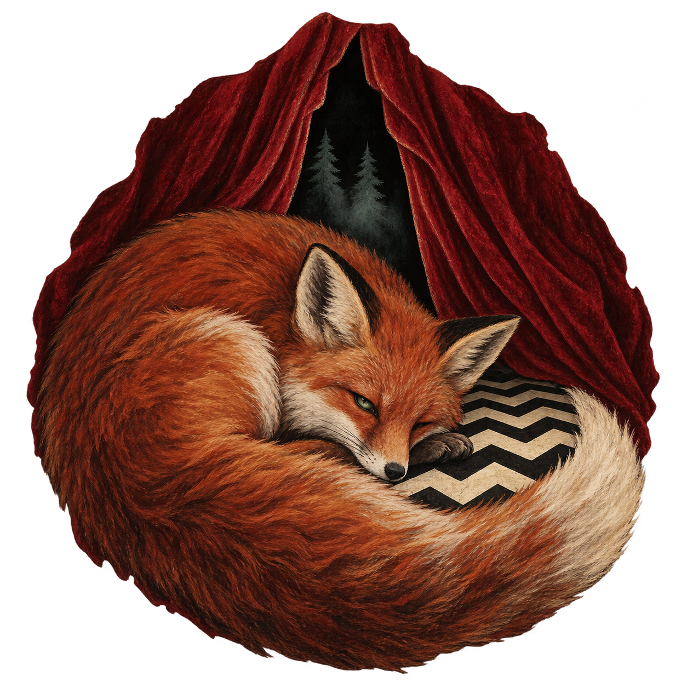

# Firefox Walk With Me

The skin's emblem is a half-awake fox in front of red velvet curtains, with Douglas firs in the dark opening and an ivory/black chevron floor. Tactile fur, worn pigment and irregular edges connect the mark to the Northwest landscape and the Black Lodge.

The original transparent PNG is preserved. The build embeds it into a self-contained scalable icon wrapper and the green/brown desktop wordmark. The Owl Cave Start icon and recognizable Firefox browser icon remain separate identities.

Generated with the built-in imagegen tool on 17 October 2026. `transparent_background` was true. No reference image was supplied.

## Exact generation prompt

Use case: logo-brand, painterly illustrated emblem for an unofficial desktop skin named Firefox Walk With Me. Create a single atmospheric, unmistakably Twin Peaks / Black Lodge-inspired fox emblem on a truly transparent background. A natural, softly painted red fox curls asleep with one eye slightly open in front of a parting pair of heavy wine-red velvet theatre curtains; through the narrow curtain opening there is impossible blackness and two small misty Douglas fir silhouettes. Its long organic, furred tail forms a loose crescent around a small patch of the iconic broad black-and-ivory zigzag Black Lodge floor. The fox has a tiny eerie muted green glint in its otherwise natural eye. Mood: a mysterious object on an early-1990s surreal television title card, quiet rural Pacific Northwest dread, dream logic, old hand-painted theatre poster, velvet and forest rather than cyberpunk. Medium: delicate hand-painted gouache and slightly distressed vintage screenprint, softly irregular edges, tactile fur and velvet folds, restrained aged ivory, oxblood red, deep woodland green and brown-black. Composition: one compact, legible cohesive emblem, about 80% of a square canvas, centered, recognizable fox silhouette first, curtains and floor simple bold secondary shapes. No lettering; the exact project title will be typeset separately. No circle outline or geometric badge frame, no sharp polygon fox face, no robot or metal or circuit pattern, no gaming mascot, no shield, no flat corporate vector styling, no polished 3D render, no glowing neon. Do not copy any existing Firefox logo. It should feel haunted, intimate and handmade.
